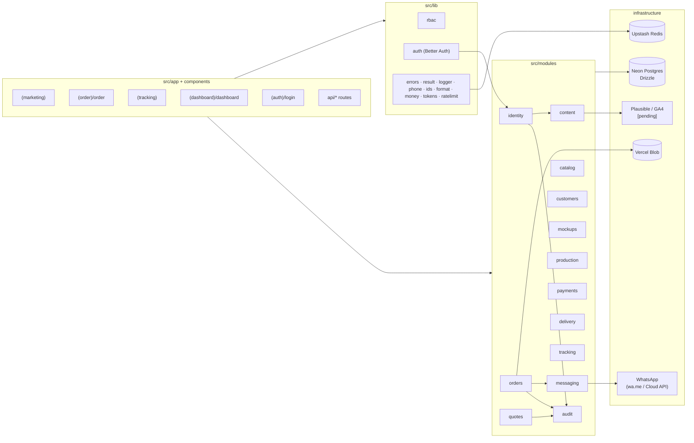
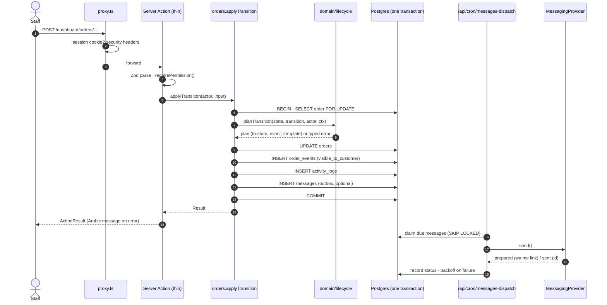
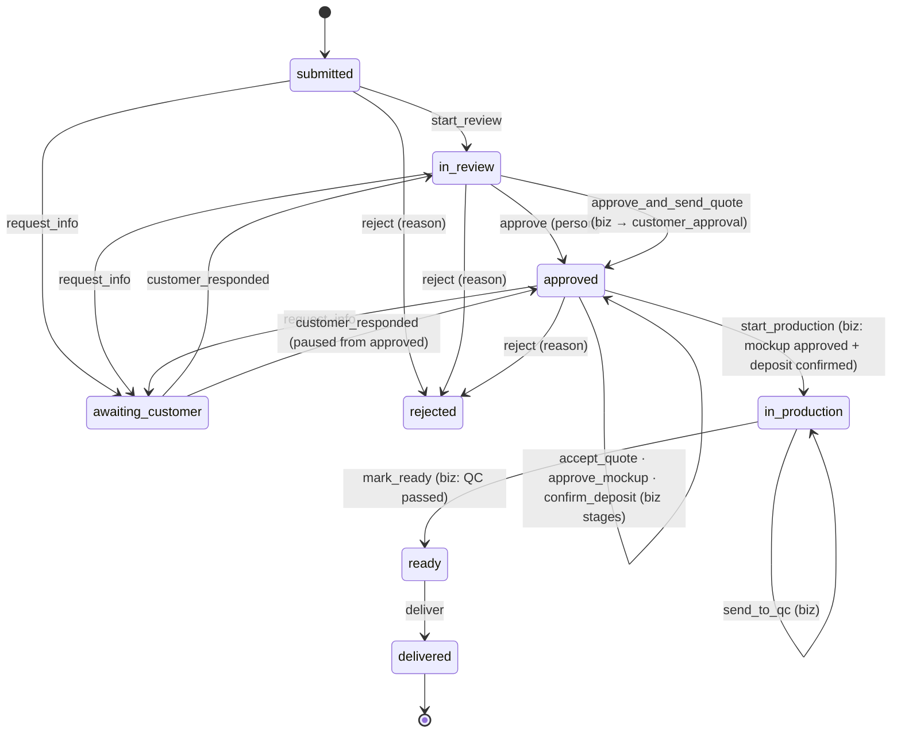

# Architecture

Modular monolith in one Next.js 16 app (ADR-0001). Business rules live in pure `domain/` code;
use cases in `application/` orchestrate permissions, transactions, audit and messages.

## Module map

| Module       | Owns                                                                 | Phase 0 state                                  |
| ------------ | -------------------------------------------------------------------- | ---------------------------------------------- |
| `identity`   | staff, roles, permissions, invitations, sessions, access requests    | working                                        |
| `audit`      | `activity_logs`, sensitive-access flag                               | working                                        |
| `orders`     | orders, sizes, places, files, pieces, events, **lifecycle**, submit  | state machine + `submitOrder` + draft uploads + lifecycle |
| `messaging`  | templates, outbox, providers                                         | working (manual provider)                      |
| `content`    | settings, site content, gallery, reviews, analytics reader           | settings + demo analytics                      |
| `catalog`    | categories, products, options                                        | seed data                                      |
| `quotes`     | quote versions, expiry                                               | expiry cron                                    |
| `tracking`   | links, ref+phone verify (no OTP, ADR-0007), signed session, DTO      | working (token deep-link still placeholder)    |
| `customers`, `mockups`, `production`, `payments`, `delivery` | their tables                          | schema only (Phases 1–4)                       |

## Request flow: a staff action

## Request flow: a page in the dashboard

1. `proxy.ts`: no session cookie → redirect to `/login?next=…`.
2. The layout's static shell renders immediately; the sidebar (built from permissions), the user
   menu and the page stream in behind `<Suspense>` (ADR-0006).
3. The page calls `requirePagePermission(permission)`:
   - no session → redirect to `/login`
   - 2FA enforced but not set up → redirect to `/dashboard/security`
   - missing permission → `forbidden()` renders `app/forbidden.tsx` with "request access".

## Order lifecycle

See `src/modules/orders/domain/lifecycle.ts`. The tests in `lifecycle.test.ts` enumerate every
transition × status × business stage × path (1,350 combinations), plus guards and permissions.

